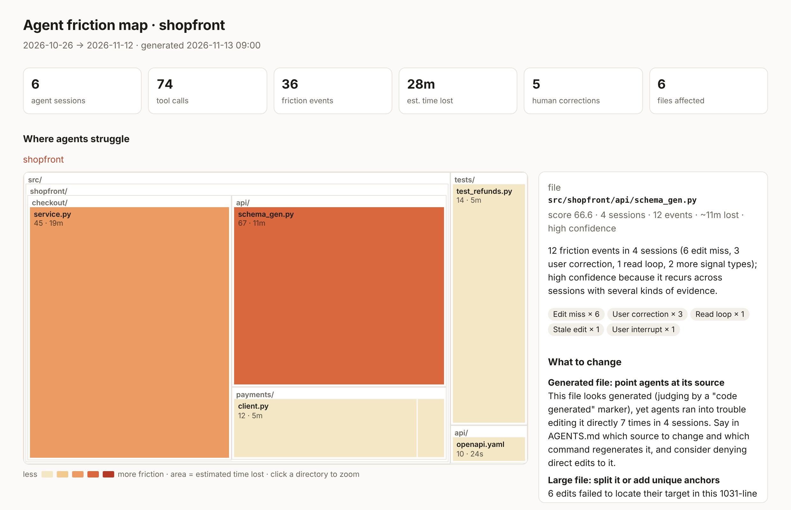

# agent-friction

[](https://github.com/nurettincoban/agent-friction/actions/workflows/ci.yml)
[](https://github.com/nurettincoban/agent-friction/blob/main/LICENSE)


**Find the places in your codebase where coding agents keep getting stuck, and get the receipts.**

Your agent fails `pytest` because this repo needs `make test`. It burns three edits on a generated
file it should never touch. You type "no, use `PaymentClient`" for the fourth time this month.
Each one is small. Together they are where your agent time goes, and nobody writes them down.

`agent-friction` reads the transcripts your coding agent already leaves on disk, finds those
recurring failures, pins them to files, directories, and commands, and tells you what to change,
with the evidence quoted so you can check it yourself.



```console
$ agent-friction scan
agent-friction · shopfront
6 sessions · 74 tool calls · 34 friction events (11 weak) · ~9m lost · 4 human corrections

Files where agents struggle
  score            path                                   sess events    lost  top signals
  █████▋      56.8 src/shopfront/api/schema_gen.py           4     12      4m  ● edit-miss×6, user-correction×2
  ████▍       43.4 src/shopfront/checkout/service.py         3      6      2m  ● edit-revert×2, user-correction×2

Commands that keep failing
  ████▉       48.6 pytest                                    4      7      3m  ◐ command-failure×7

What to fix first
  1. src/shopfront/api/schema_gen.py: Generated file: point agents at its source
     ...agents ran into trouble editing it directly 7 times in 4 sessions. Say in AGENTS.md
     which source to change and which command regenerates it...
  2. pytest: Tell agents to use `make test`
     `pytest` failed 7 times in 4 sessions; 5 times the agent then got the same job done with
     `make test`, and `pytest` did not work later in those sessions.
  3. src/shopfront/checkout/service.py: Write down the rule the human keeps repeating
     ...In their words: "No, I said use PaymentClient, not the legacy module. [...]"
```

That output is real, abridged to its top rows: it comes from the synthetic sessions in [`tests/fixtures`](https://github.com/nurettincoban/agent-friction/tree/main/tests/fixtures).
See the full example as [Markdown](https://github.com/nurettincoban/agent-friction/blob/main/examples/shopfront.md), [JSON](https://github.com/nurettincoban/agent-friction/blob/main/examples/shopfront.json),
or [interactive HTML](https://github.com/nurettincoban/agent-friction/blob/main/examples/shopfront.html) (download it and open it in a browser).

## Why this exists

Agent observability tools tell you about **sessions**: tokens, cost, latency. Linters and code
health tools tell you about **code**. Nothing connects the two, so the questions a team actually
has go unanswered:

- *Which parts of our codebase are hard for agents, and why?*
- *What should go in `AGENTS.md` / `CLAUDE.md`, and what is already wasted effort?*
- *We fixed it. Did it actually help?*

`agent-friction` answers those with a map keyed by **your repo's paths**, ranked by **recurrence
across sessions** (one bad session is noise, the same failure in five sessions is a pattern), and
backed by **evidence** you can trace to a transcript line.

## Install

Requires Python 3.10+. No dependencies. Not on PyPI yet, so install from GitHub:

```sh
pipx install git+https://github.com/nurettincoban/agent-friction
# or run it without installing:
uvx --from git+https://github.com/nurettincoban/agent-friction agent-friction scan
```

## Use

```sh
cd your-repo
agent-friction scan                        # friction map in the terminal
agent-friction scan --since 30d -o map.html  # interactive treemap, one self-contained file
agent-friction scan -o friction.md         # Markdown for an issue or a PR
agent-friction show src/api/client.py      # why one file scores high, with evidence
agent-friction show "npm test"             # the same for a command, or a directory
agent-friction sources                     # which transcripts it found
```

By default it finds Claude Code sessions for the repo (its subdirectories, its git worktrees, and
sessions started in a parent directory that worked inside it)
under `~/.claude/projects` (or `$CLAUDE_CONFIG_DIR`). Point it elsewhere with `--transcripts`.
If the sessions were recorded where the repo lived at another path (a teammate's laptop, a CI
runner, an old checkout), add `--repo-alias /that/path`.

### It reads what you already told your agents

Before it suggests a line for `AGENTS.md`, it checks `AGENTS.md`, `CLAUDE.md` (including nested
ones), `.github/copilot-instructions.md`, `.cursorrules`, `.cursor/rules/` and the deny rules in
`.claude/settings.json`. If the advice is already written down and agents still trip over it, it
says so ("`AGENTS.md:3` already names `make test`, yet agents run `pytest`"), asks you to
confirm the cited line really says this, and then suggests enforcing it (a hook, a permission
rule, a wrapper) instead of adding another line. A line that only mentions the command or file
in passing is cited as "also mentioned", and the usual advice stays. See
[What the repository already says](https://github.com/nurettincoban/agent-friction/blob/main/docs/methodology.md#what-the-repository-already-says).

Dependencies and build output (`node_modules`, `.venv`, `site-packages`, git-ignored directories)
are left out of the map, since agents reading library code is not a problem in your code.

### The improvement loop

The point is not the report, it is the fix. Measure, change something, measure again:

```sh
agent-friction scan --until 2026-11-01 -f json -o before.json
# ...add the missing line to AGENTS.md, split the file, add the script...
agent-friction scan --since 2026-11-01 -f json -o after.json
agent-friction compare before.json after.json
```

`compare` measures each file and command against the sessions that actually touched it (events per
10 exposed sessions), so a file nobody worked on afterwards shows up as "not touched", not as
"resolved". When the fix was "use `make test`, not `pytest`", success means agents stop running
`pytest`, so `compare` checks the recommended command instead: if it ran cleanly afterwards, the
old one is reported as "replaced". A fix that keeps agents away from a file (a denied edit) can
only show as "not touched"; that is the expected outcome, not proof. It ignores changes too small to mean anything, warns when either side has too few
sessions, refuses to compare scans of different repositories, and refuses scans whose time windows overlap
(a later scan without `--since` contains the earlier one, which would only dilute it). Both scans must use the
same privacy mode: compare two `--no-excerpts` scans, or two scans without it.

### For a team, and in CI

Transcripts live on the machines where the agents ran (`~/.claude/projects/<encoded path>/` for
Claude Code), not in the repository, so a CI runner has none of its own. To map a whole team:

1. Each developer copies their project's transcript directory to a shared place. It holds
   prompts and command output, so treat it like any log of internal work, or share
   `agent-friction scan --no-excerpts -f json` results instead when only the numbers matter.
2. Scan the pooled directory, naming every path the repository was checked out at:

```sh
agent-friction scan --transcripts pooled/ \
  --repo-alias /home/ana/src/shop --repo-alias /Users/ben/work/shop --repo-alias 'C:\dev\shop'
```

If you leave an alias out, the error lists the directories the sessions ran in and suggests the
`--repo-alias` to add.

Both gates exit with code 3, so they can fail a job wherever transcripts are available (a
scheduled job over the pooled directory, or a developer's machine before a release):

```sh
agent-friction scan --transcripts pooled/ --repo-alias /home/ana/src/shop --since 30d --fail-on 45
agent-friction compare before.json after.json --fail-on-regression
```

`--allow-empty` makes "nothing to analyse" a report instead of an error, for jobs that may run
before any transcripts arrive.

Exit codes: `0` ok, `1` error (for example no transcripts found), `2` bad arguments, `3` gate
tripped.

## What it detects

Each signal is a deterministic rule over the transcript, documented with its exact definition,
attribution rule, and known false positives in [docs/signals.md](https://github.com/nurettincoban/agent-friction/blob/main/docs/signals.md).
A "friction event" is one firing of a signal, so the derived signals add to the count: four
failed runs of the same line in a row are four `command-failure` events plus one `retry-loop`. Time is not
double-counted that way; each minute is claimed once.

| Signal | What happened |
|---|---|
| `user-correction` | The human corrected the agent ("no, use X", "I said…", "you broke…") and the agent went back to the work it had just done |
| `probable-correction` | Words that sound like a correction, without behaviour to back them up (weighted low, never quoted) |
| `retry-loop` | The same command line, with identical arguments, failed 3+ times with no change in between |
| `tool-rejected` | The human declined a tool call (and often said why) |
| `permission-denied` | A permission rule, hook, or safety check refused a tool call before it ran |
| `user-interrupt` | The human stopped the agent mid-action |
| `human-rework` | A human rewrote lines an agent commit had just written, or committed a fix/revert of it (git) |
| `edit-miss` | An edit could not find its target text, or found it more than once |
| `edit-revert` | An edit undid an earlier edit in the same session |
| `command-failure` | A command failed because of setup, invocation, or the environment (a service down, credentials, an unset variable); a red test the agent then fixes is not counted, one that passed only after a setup step is |
| `no-convergence` | The agent kept editing and re-running the same check, and it never went green |
| `edit-thrash` | One file edited 6 or more times in one turn while something kept failing |
| `stale-edit` | An edit refused because the file changed or was never read |
| `path-miss` | The agent read or edited a path that does not exist |
| `search-miss` | A search in a file or directory came back empty |
| `file-too-large` | The agent could not read a file because it is too large for its context |
| `read-loop` | The same part of a file read 3 or more times without being edited |

### Reading the report

- **Score (0-100).** Severity × how often it **recurs** across episodes of work × how
  **consistently** it happens in the sessions that touch the target at all, so a busy file is not
  penalized for being busy. Under 20 is an incident, 20-45 a pattern, above 45 a reliable
  struggle. Every score can be reproduced by hand from its `score_detail` in `-f json`.
- **What is not counted.** Red-then-green test runs with a fix in between are normal work. Weak
  signals on their own (re-reads, many edits, an empty search) stay in the incident band unless
  the same pattern recurs across sessions; the headline says how many events are weak.
- **Episodes.** A long-running session (`claude --continue`) counts once for every time a human
  picked it up again after two hours or more of silence. Subagents belong to the episode of the
  agent that started them.
- **Time lost** is a floor estimate of agent time from timestamps. A correction claims only the
  rework it caused. Time a person spends is never counted: not the wait before a reply, and not
  a permission prompt that stood open. Where Claude Code records how a call was approved, a
  person-approved call claims only what followed its result; where it does not say, call to
  result counts up to 30 seconds, or the command's usual run time in that session if longer. No
  single event claims more than 5 minutes (a no-convergence stretch, 15). `n/a` means the
  evidence carries no time estimate.
- **Confidence** (low / medium / high) depends on how many sessions back a hotspot and whether an
  independent second kind of evidence agrees.

All of it is in
[docs/methodology.md](https://github.com/nurettincoban/agent-friction/blob/main/docs/methodology.md).

## Privacy

Transcripts contain your code and sometimes your secrets, so:

- Everything runs locally. No network calls, ever. The HTML report loads nothing external and
  ships a Content-Security-Policy that blocks every network load (`default-src 'none'`; its own
  inline script and styles are the only code it runs).
- Excerpts are redacted (API keys and tokens, `Authorization` headers, private keys, common
  password forms, credentials in URLs and `curl -u`, emails, high-entropy strings, your home
  directory) and truncated. Thinking blocks and assistant prose are never included.
- `--no-excerpts` removes all transcript text: prompts, quoted corrections, search patterns,
  command lines, and output. What remains is paths, counts, timestamps, and normalized command
  names built only from publicly known words (`git commit`, `npm test`, `python -m pytest`).
  Project-specific names (your own scripts, make targets, tools) become short hashes such as
  `make <target:37bd73>`: stable, so grouping still works, but a pseudonym rather than
  anonymous, since someone who guesses the name can confirm it.
- Even with `--no-excerpts`, reports always show your repository's file paths, its directory
  name, and when sessions happened. Those are the map itself. A path the agent guessed that
  never existed becomes a hash too (`src/<path:3f9a1c>`), since it may name something private.
- Session ids are taken from the transcript file name (a UUID for Claude Code), and are shown
  even with `--no-excerpts`. If you pool transcripts under descriptive file names, rename them
  before sharing a report.

Redaction is pattern-based: it catches secrets that look like secrets, not an opaque password
typed as a bare argument. Skim a report before you share it outside your team, or use
`--no-excerpts`.
See [SECURITY.md](https://github.com/nurettincoban/agent-friction/blob/main/SECURITY.md).

## Supported agents

| Agent | Support |
|---|---|
| Claude Code | Native, auto-discovered, including subagents and resumed sessions |
| Anything else | Convert to the [generic JSONL format](https://github.com/nurettincoban/agent-friction/blob/main/docs/schema.md#generic-transcript-format): one event per line, a few fields |
| Git history | Any agent that marks its commits (`Co-Authored-By: Claude`, Codex, Copilot, Cursor, Aider, …). Without any transcripts, run `scan --allow-empty` for a git-only map |

Native adapters for other agents are welcome; see [CONTRIBUTING.md](https://github.com/nurettincoban/agent-friction/blob/main/CONTRIBUTING.md).

## Output contract

`scan -f json` produces a versioned document (`schema_version: 1`) described field by field in
[docs/schema.md](https://github.com/nurettincoban/agent-friction/blob/main/docs/schema.md). Build dashboards or bots on it: within a schema version fields are only
added, never removed or re-typed. Until 1.0 the project is alpha, so new fields can still arrive
in any release; from 0.1.0 on, each one is listed in the CHANGELOG.

## Limitations

- A command run in the background is judged by what the agent later reads of it (`BashOutput`,
  a task notification). One that is never polled and never reports back has no outcome.
- Heuristics, not ground truth. A red test that the agent then fixes is normal work, not
  friction, and the rules try hard not to count it; they will sometimes be wrong both ways.
  `show` exists so you can check.
- A correction is counted only when the human's words address the agent's work and behaviour
  backs it up: they name a file the agent just changed, or the agent goes back to one. Anything
  else that merely sounds like a correction is "probable": shown as evidence, weighted lower,
  never quoted, and excluded from the headline count. It is English-only and still a heuristic,
  so treat the count as a floor.
- Time lost is a floor, not a measurement of human time.
- One session is a lead, not a pattern: a row seen in a single session gets advice only when it
  scores 20 or more on its own (one long struggle) or a human said the rule in their own words.
- When a command's exit status is hidden (`pytest | tail`, `cmd; echo done`), the verdict comes
  from its output. If the filter cut the summary line away, the run counts as neither red nor green.
- Changes made by commands are inferred, not seen. `sed -i`, formatters, `--fix`, codemods,
  `mv`/`cp`/`rm` and inline scripts that write files count as edits; any other command that is
  neither a look nor a check counts as "may have changed something", enough to end a retry loop
  or make the next green run a fix. Changes made outside the transcript (your editor, another
  agent) are missed, so a check someone else fixed can still show as failing. Agents that edit
  mostly through shell commands also leave fewer traces of edit friction.

Reports of wrong or missed hotspots are the most valuable contribution you can make:
[open one here](https://github.com/nurettincoban/agent-friction/issues/new?template=false_positive.yml).

## Contributing

`make install && make check`. See [CONTRIBUTING.md](https://github.com/nurettincoban/agent-friction/blob/main/CONTRIBUTING.md) for the ground rules (zero
dependencies, every heuristic documented and tested in both directions, deterministic output).

## License

[MIT](https://github.com/nurettincoban/agent-friction/blob/main/LICENSE)
